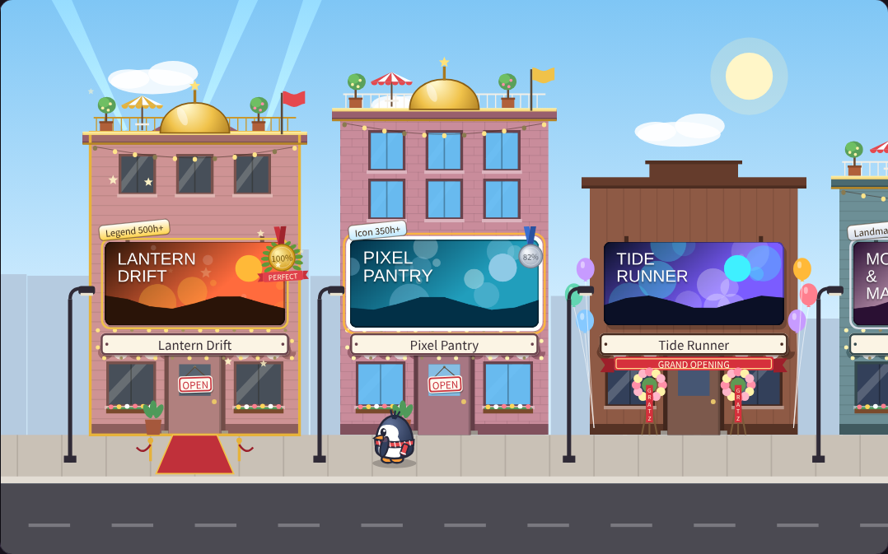
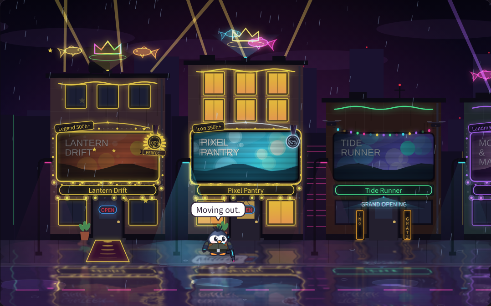

# Minimi Town

**Your Steam Deck library as a little street.** Every game is a storefront, and a baby penguin walks along the street to whichever one you pick. Press Ⓐ and it waddles to the door, turns around and goes in, and the game's page opens. Come back and it steps out of the same door.

**[▶ Try the live demo](https://justinca92.github.io/minimi-town/)**: the plugin's own street in your browser, with made-up games.

[한국어](#한국어) · [](https://ko-fi.com/jhw0806)

| Minimi Town | Neon Rain City |
|---|---|
|  |  |

## Features

- **A street instead of a row of tiles.** Each game gets its own building (the same one every time), with the game's art on its storefront screen and its name on the sign.
- **Two themes.** *Minimi Town*, a sunny street whose sky follows the clock, and *Neon Rain City*, a rainy night with CRT storefront screens and a wet street that mirrors the neon.
- **Buildings tell you what's going on.** Played this week: an OPEN sign and a plant by the door. New: GRAND OPENING with balloons and flower stands (drones, a hologram banner and LED tickers in Neon Rain City). Not installed: shutter and CLOSED. Downloading: scaffolding with a progress banner. Not played for months: dust and cobwebs, or a run-down shop with cracked and boarded windows in Neon Rain City.
- **Five playtime tiers.** 100h *Regular*, 150h *Popular*, 200h *Landmark*, 350h *Icon*, 500h *Legend*. Each one changes the building: marquee bulbs round the sign, a rooftop garden (hologram koi in Neon Rain City), a whole extra floor with a golden dome (a neon crown), then the red carpet and gold.
- **Achievement medals.** Bronze at 50%, silver at 80%, gold with a PERFECT ribbon at 100%, pinned to the storefront screen.
- **Game info on the back.** Press Ⓧ and the screen turns round: icon, playtime, last played, achievements, friends playing.
- **A penguin with moods.** It follows you along the street, sprints when you rush, drops behind when you flick through fast, and arrives out of breath. Poke it, throw it into a wall, or pet it. Bother it too much and it sulks (in Neon Rain City it shoots). Don't want it? Turn it off in the panel.
- **The left trackpad is a hand.** Rub to pet, a quick click to poke, click and hold to pick the penguin up, flick and let go to throw it. Works without a touchscreen too (Steam Controller, Steam Machine).

## Controls (home)

| Input | Action |
|---|---|
| D-pad / left stick ◀ ▶ | Move along the street |
| Ⓐ | The penguin goes in and the game's page opens (Play / Install are there) |
| Ⓧ | Turn the storefront screen round: game info on the back (Ⓧ again turns it back) |
| Ⓨ | Shake the street |
| L2 | Search, like ▲ on the stock home (R2 there: back to the street; Ⓑ there: Steam's menu) |
| R2 | What's New / Friends / Recommended (Steam's own sections), sliding in from the right |
| L2 there (or swipe right) | Back to the street |
| Ⓑ there | To the top of the sections; at the top, Steam's menu |
| ≡ | Steam's game menu (Play, Properties, …) |
| Left trackpad | The penguin's hand: rub to pet, quick click to poke, hold to pick up, flick and let go to throw |
| Touchscreen | Swipe to move, double-tap to play, grab / poke / pet the penguin |

D-pad ▲ ▼ do nothing on the street. Settings live in Quick Access (…) → Minimi Town: home toggle, theme, sky, storefront screens (wide or tall), which games, sort, show the penguin, sounds, haptics and language.

## Install (Decky developer mode)

Minimi Town isn't in the Decky store yet.

1. Install [Decky Loader](https://decky.xyz).
2. Quick Access (…) → Decky → ⚙️ → **General** → turn on **Developer mode**.
3. **Developer** tab → **Install Plugin from URL** (the `minimi-town-x.y.z.zip` link from the [latest release](https://github.com/justinca92/minimi-town/releases/latest)) or **Install Plugin from ZIP**.

If you also use Spindeck, turn off its "Use the wheel as Home" so the two don't both replace the home screen.

## Uninstalling leaves nothing behind

Minimi Town never changes Steam's settings, controller layouts or files. The trackpad hand only borrows Steam's own keyboard-trackpad mode (the one its radial menus use) while the street is in front, and hands it back whenever you leave. Turning the home toggle off shows Steam's own home; disabling or uninstalling the plugin restores everything immediately, and uninstalling deletes its settings file (which is also where the penguin's mood is kept).

## Building

```sh
bun install
bun build/build.ts          # → dist/index.js
./scripts/package.sh        # → release/minimi-town-x.y.z.zip
./tools/demo/build.sh       # → docs/index.html (the browser demo)
```

## Credits

Built on Spindeck's home-screen plumbing. The penguin, the buildings and every piece of art in the street are drawn in code; game art comes from your own Steam library. Games in the demo are made up.

---

## 한국어

**스팀덱 라이브러리를 작은 거리로.** 게임 하나가 가게 하나이고, 아기 펭귄이 고른 가게 앞까지 걸어가요. Ⓐ를 누르면 문 앞으로 뒤뚱뒤뚱 걸어가 뒤돌아 들어가고 게임 페이지가 열려요. 돌아오면 같은 문에서 걸어 나와요.

**[▶ 브라우저 데모](https://justinca92.github.io/minimi-town/)**

- **조작:** ◀ ▶ 이동 · Ⓐ 게임 페이지 · Ⓧ 게임 정보(화면이 뒤집혀요) · Ⓨ 흔들기 · L2 검색 · R2 새 소식·친구·추천(오른쪽에서 밀려 들어옴, L2로 복귀) · ≡ 게임 메뉴
- **왼쪽 트랙패드:** 문지르면 쓰다듬기 · 짧게 클릭하면 콕 · 누르고 있으면 잡기 · 튕기고 손 떼면 던지기
- **테마:** 미니미 타운(시간 따라 바뀌는 하늘) / 네온 레인 시티(비 오는 밤, CRT 화면, 젖은 바닥 반사)
- **가게 상태:** 이번 주에 한 게임은 OPEN, 새 게임은 GRAND OPENING, 설치 안 된 게임은 CLOSED, 오래 안 한 게임은 먼지(네온은 허름한 가게)
- **플레이 시간 등급:** 100시간 단골 · 150시간 인기 · 200시간 명소 · 350시간 명물 · 500시간 전설, 단계마다 건물이 업그레이드돼요
- **업적 메달:** 50% 동 · 80% 은 · 100% 금(PERFECT)
- **설정:** Quick Access(…) → Minimi Town (펭귄 끄기도 여기서)
- **설치:** Decky 개발자 모드 → URL 또는 ZIP으로 설치. Spindeck을 같이 쓴다면 Spindeck의 홈 교체를 꺼 주세요.
- 지우면 아무것도 남지 않아요. Steam 설정·컨트롤러 레이아웃·파일을 건드리지 않아요.
